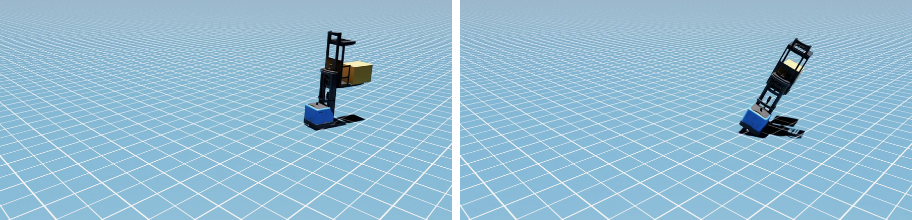
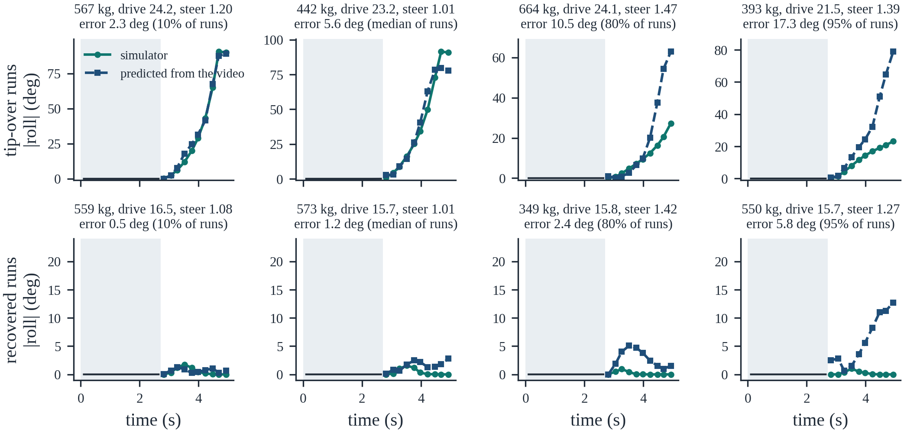
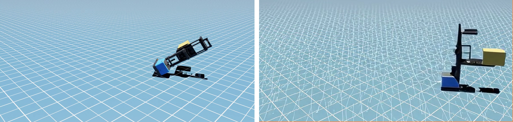

# Physical Safety Query (PSQ)

PSQ predicts a forklift's hidden payload and its future stability from a short video. The same readout then tests whether a video world model keeps that physical state in the futures it generates.

[Project page](https://juhwanhan.shb06083.workers.dev/) · Paper: *Physical Safety Queries Reveal What Video World Models Forget*, ECCV 2026 Workshop (oral, Best Paper Award runner-up)



*Same route, drive command and payload mass. Moving the payload's centre of mass 0.25 m sideways turns a recovery (left, peak roll 3°) into a tip-over (right, peak roll 25°).*

## Task

The input is the first 2.7 s of a fixed-camera video (65 frames at 24 FPS). PSQ predicts, in physical units:

| Target | Output |
|---|---|
| Hidden payload properties | Payload mass (kg) and lateral centre-of-mass offset (m) |
| Future trajectory | Roll, velocity, centre of mass, zero-moment point (ZMP) and ZMP stability margin at 10 time points over the next 2.3 s |
| Outcome | Tip-over probability |

A frozen V-JEPA 2.1 encoder turns the video into a 10 × 12 × 12 grid of tokens. A small cross-attention decoder (about 0.6 M trainable parameters) reads the targets from that grid, and every prediction is compared with the simulator log.

For the world-model audit, the readout is trained on LTX-2.3 latents of real futures, frozen, and applied to futures that LTX-2.3 generates from the same 2.7 s prefix. The difference between the two is the physical state lost in generation.

## Results

### Prediction from 2.7 s of video

ForkSafe-CF v2 has 800 matched pairs (1,600 runs) with continuous payload mass, centre-of-mass offset, drive command and steering command. Results use pair-grouped five-fold cross-validation: every run is predicted by models that never saw its pair.

| Quantity | Error | Error when predicting the training mean |
|---|---:|---:|
| Payload mass | 27 kg (R² 0.95) | 118 kg |
| Future roll | 5.5° | 14.1° |
| Future ZMP margin | 0.051 m | 0.066 m |
| Tip-over | AUROC 0.962 | |

| Predictor input | Tip-over AUROC | Future roll error |
|---|---:|---:|
| Planned command only | 0.888 | 7.1° |
| Observed video | 0.962 | 5.5° |
| Planned command + payload mass read from the video | 0.969 | 5.1° |
| Planned command + true payload mass | 0.972 | 5.0° |

The payload mass read from the video is almost as useful as the true mass. In the 89 pairs that share a command and differ in mass and outcome, it ranks the tipping run higher in 98%.



*Roll predicted from the 2.7 s observation (shaded) against the simulator, for held-out runs at the 10th, 50th, 80th and 95th error percentiles.*

### Real and generated futures

| Readout applied to | Payload mass error | Future roll error | ZMP margin error | Tip-over AUROC |
|---|---:|---:|---:|---:|
| Real future | 31 kg | 2.8° | 0.035 m | 0.990 |
| Future generated by LTX-2.3 | 98 kg | 18.7° | 0.076 m | 0.758 |

Measured on 140 held-out v2 runs. On the workshop benchmark (ForkSafe-CF v1, 1,008 matched pairs) the same audit gave 14.5 → 95.5 kg, 2.25° → 16.16° and AUROC 1.000 → 0.761.



*Payload of 720 kg with its centre of mass shifted 0.25 m. The simulator tips over (left) and the generated future stays upright (right).*

### Mechanics of the benchmark

- `analysis_thesis/truecom.py` computes the system centre of mass, a multi-body ZMP and the stability margins from rigid-body properties. The ZMP agrees with the wheel-load centre of pressure within 0.015 m (longitudinal) and 0.033 m (lateral).
- A roll-over criterion with no fitted constant, turn severity `|v ω|` against `g (b − y_c) / h` about the outer fork rollers, classifies 96% of v1 runs and 94% of v2 runs (`analysis_thesis/rollover_criterion.py`).

## Repository

| Path | Contents |
|---|---|
| `src/safety_probing/` | Dataset audit, leakage-safe splits, V-JEPA and LTX feature extraction, the query decoder and its training |
| `analysis_thesis/` | Follow-up study: stability labels, ForkSafe-CF v2, cross-validated prediction, mechanics and figures ([index](analysis_thesis/README.md)) |
| `configs/` | Dataset roots, model registry, hardware profiles and experiment settings |
| `docs/` | Dataset card, schema, probing protocols and result summaries |
| `tests/` | Unit tests |

## Quick start

```bash
uv sync --locked --extra vision-audit --extra model-prep --extra inference-core
.venv/bin/safety-probing all --config configs/local_dataset.json
```

Simulator outputs are read from the dataset roots listed in `configs/local_dataset.json`. The command audits every shard, builds the splits and writes the pair and run manifests used by feature extraction.

The remaining steps (model download, LTX-2.3 rollouts, V-JEPA features, training and evaluating the readouts) are in [docs/PIPELINE.md](docs/PIPELINE.md). The follow-up experiments are indexed in [analysis_thesis/README.md](analysis_thesis/README.md).

## Documents

- [Pipeline commands](docs/PIPELINE.md)
- [Dataset card](docs/DATASET_CARD_KO.md), [schema reference](docs/SCHEMA_REFERENCE.md) and [generated statistics](docs/DATASET_STATISTICS_KO.md)
- [Probing protocol](docs/PROBING_PROTOCOL_KO.md)
- [Physical Safety Query results](docs/Summary_to_Safety_Query.md)
- [LTX-2.3 audit protocol](docs/LTX_SAFETY_QUERY_PROTOCOL_KO.md) and [results](docs/Summary_to_LTX_Safety_Query.md)

## Citation

```bibtex
@inproceedings{han2026physical,
  title     = {Physical Safety Queries Reveal What Video World Models Forget},
  author    = {Han, Juhwan and Kim, Taehun and Lee, Donghyu and Kim, Sayhee and Jo, Soo-Ho and Youn, Byeng D.},
  booktitle = {Safe World Models for Trustworthy Embodied AI, ECCV Workshop},
  year      = {2026}
}
```
