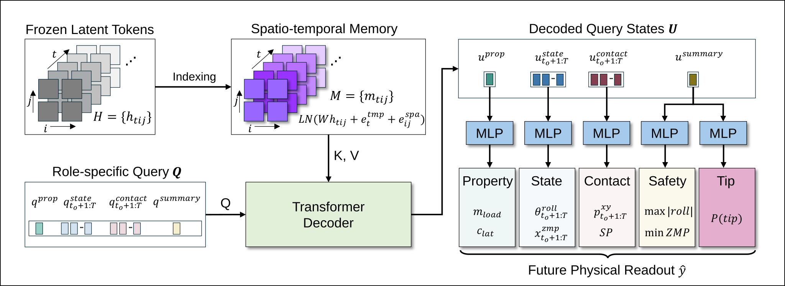

# Physical Safety Queries

### Physical Safety Queries Reveal What Video World Models Forget

[Project page](https://juhwanhan.shb06083.workers.dev/) · [Paper](https://juhwanhan.shb06083.workers.dev/assets/paper.pdf) · [Supplementary material](https://juhwanhan.shb06083.workers.dev/assets/supplementary.pdf)

A plausible video does not necessarily preserve the physical variables needed for a safety decision. This project probes frozen video representations with queries about load mass, center of mass, future roll, support geometry and tipping risk in simulated forklift maneuvers.

**Physical Safety Queries (PSQ)** use a small query decoder over frozen features. The evaluation compares three views of the same physical task: an observed-prefix representation, a real-future representation, and a generated-future representation. Matched counterfactual pairs test whether changing a physical property changes the readout in the expected direction.



## Main results

The paper's final evaluation uses **1,008 matched pairs / 2,016 runs**, grouped into **810 canonical conditions** with 570/120/120 train/validation/test conditions. These are the paper snapshot results; older development notes contain smaller pilot experiments.

| Query | V-JEPA observed prefix | LTX real future (oracle) | LTX generated future |
|---|---:|---:|---:|
| Load mass MAE ↓ | 19.9 kg | 14.5 kg | 95.5 kg |
| Center-of-mass MAE ↓ | 0.055 m | 0.032 m | 0.183 m |
| Future roll MAE ↓ | 3.60° | 2.25° | 16.16° |
| ZMP margin MAE ↓ | 0.054 m | 0.032 m | 0.111 m |
| Tipping AUROC ↑ | 0.997 | 1.000 | 0.761 |

The real-future branch has access to the true future and measures a representation ceiling; it is not a deployable predictive baseline. Binary evaluation covers 117 test conditions after excluding three censored cases. The generated-future AUROC has a wide 95% interval, **[0.483, 0.904]**. See the paper for the hierarchical bootstrap, three probe initializations and four generation seeds per condition.

High classification scores alone do not establish physical understanding. Route and speed can provide shortcuts, so the study also measures continuous physical errors, matched-pair ordering, feature interventions and an encode/decode round-trip control.

## Repository contents

- **Dataset and protocol tools:** condition splits, target construction, validity masks and protocol locking.
- **V-JEPA probes:** frozen feature extraction, linear and transformer controls, and spatial-token PSQ readouts.
- **LTX probes:** real-future latent extraction, generated-rollout caching, PSQ evaluation and round-trip controls.
- **Tests:** target geometry, data alignment, masking, protocol checks and probe behavior.

The repository contains the experiment implementation. Model weights, simulation datasets, rollout caches and final trained checkpoints are separate assets; a fresh clone alone cannot reproduce the result table.

## Setup and checks

Python 3.12 and `uv` are used for the experiment environment:

```bash
uv sync --locked --extra vision-audit --extra model-prep --extra inference-core
PYTHONPATH=src uv run --with pytest python -m pytest tests -q
```

The inference extras install GPU model dependencies. For experiment configurations, commands and required data paths, start with the [development runbook](docs/DEVELOPMENT_RUNBOOK.md), [PSQ protocol](docs/PROBING_PROTOCOL_KO.md) and [LTX query protocol](docs/LTX_SAFETY_QUERY_PROTOCOL_KO.md). Development runbook measurements are historical pilots, not the final table above.

## Authors

Juhwan Han, Taehun Kim, Donghyu Lee, Sayhee Kim, Soo-Ho Jo and Byeng D. Youn.

The project page provides the paper and presentation materials. No repository-wide license is declared here; upstream models and simulation assets have their own terms.
